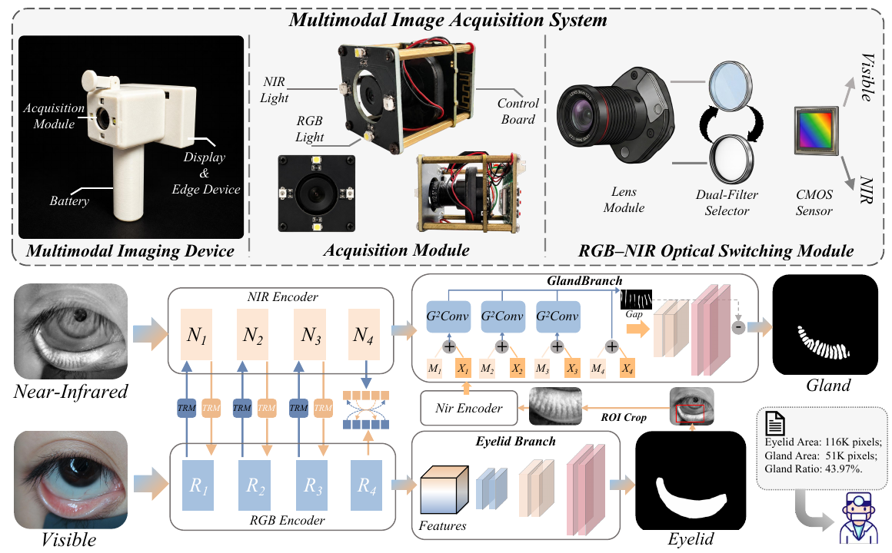
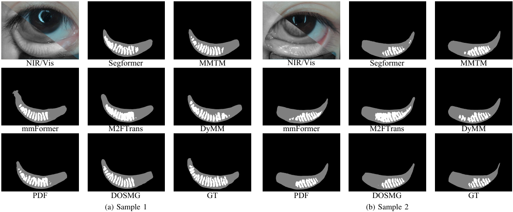

# DMOS

## A Dual-Modal Visible and Near-Infrared Imaging System for Meibomian Gland Analysis

DMOS brings together a handheld RGB–NIR imaging and analysis system, a paired ocular surface dataset, and the Dual-Modal Asymmetric Ocular Segmentation (DAOS) framework for quantitative eyelid and meibomian gland analysis.



## Overview

- **Dual-modal acquisition:** a shared optical path with visible and 850 nm near-infrared illumination; approximately 150 ms between modalities, with integrated edge computing and result visualization.
- **Asymmetric fusion:** RGB-dominant eyelid features and NIR-dominant gland features interact through task-aware residual modulation (TRM) in DAOS.
- **Anatomy-guided segmentation:** eyelid ROI refinement, high-resolution gland injection, and Gland-Gap Convolution (G²Conv) use adaptive curvilinear sampling and gap supervision to preserve fine gland structures and separation.
- **Quantitative analysis:** the MG ratio is the segmented gland area divided by the segmented eyelid area.

## DMOS dataset

DMOS contains **510 RGB–NIR image pairs from 110 eyes**, with pixel-level **eyelid and meibomian gland annotations**.


## Results

DAOS results from the manuscript (mean ± standard deviation over three random seeds: 0, 1, and 2; %):

| Dataset | Eyelid Dice | MG Dice | clDice | detF1 |
| --- | --- | --- | --- | --- |
| DMOS | 94.567 ± 0.050 | 77.650 ± 0.098 | 85.277 ± 0.108 | 56.573 ± 1.133 |
| MGD1K | 97.430 ± 0.053 | 83.150 ± 0.040 | 91.540 ± 0.066 | 41.273 ± 0.070 |

On DMOS, DAOS improves MG Dice and clDice over the strongest multimodal fusion baseline by 2.350 and 2.354 percentage points, respectively. For MGD1K, the same image is fed into both encoders to evaluate single-modality segmentation.



## Citation

```bibtex
@unpublished{wang_dmos,
  title = {A Dual-Modal Visible and Near-Infrared Imaging System for Meibomian Gland Analysis},
  author = {Wang, Zhiwei and Zhu, Meilu and Lee, Allie and Tam, Vincent and Li, Yuxing and Lam, Edmund Y.},
  note = {Manuscript}
}
```

